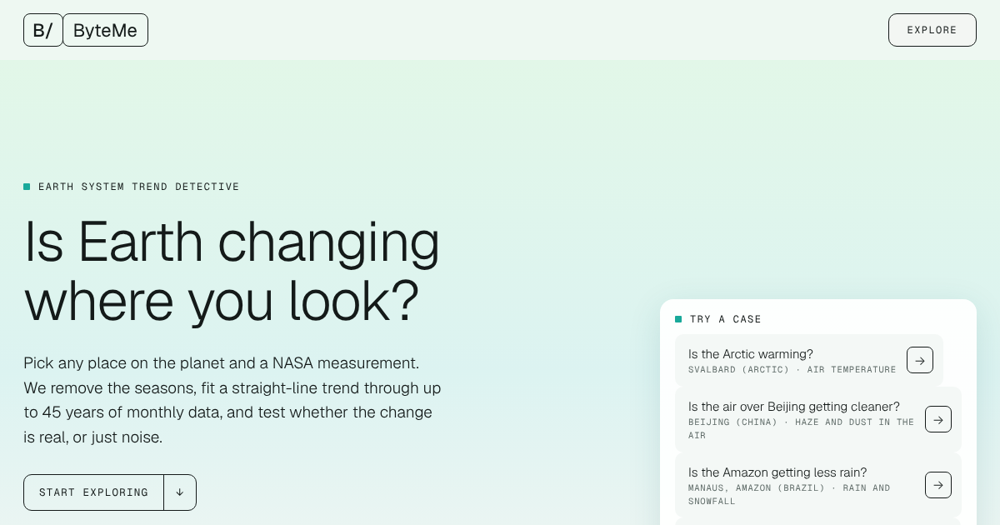

# ByteMe: Earth System Trend Detective

### 🌍 Try it live: **[byteme.earth](https://byteme.earth)**

*NASA Space Apps Challenge 2026 · Challenge: "Be An Earth System Trend Detective!" · Team **Byte Me Analytics***

Ask a question in plain words, or click any place on Earth. ByteMe reads NASA's monthly records for
that place, removes the seasons, fits a trend line and tells you **what** is changing, **where**,
**how much**, and whether the change is **statistically significant**.

> *"Is the air in Delhi getting more polluted?"* · *"Is sea level rising in Venice?"* ·
> *"Is Romania getting warmer?"* · *"Is snow disappearing in Svalbard?"*



---

## About us

We are **four first-year students** at the **Faculty of Automatic Control and Computers**
(Automatică și Calculatoare), **National University of Science and Technology POLITEHNICA Bucharest**.

We joined Space Apps because we wanted to build something real with NASA data, and we chose this
challenge because climate news is full of claims, while the data to check them is public but hard to
use. ByteMe is our attempt to make that data answer simple questions honestly.

---

## About the project

### The problem
NASA satellites and models measure hundreds of things about the Earth: temperature, rain, snow,
sea level, pollution. The data is free, but finding the right variable, downloading it for one place
and testing it for a trend takes specialist tools and skills. And the same variable can rise in one
region and fall in another.

### Our answer
A website where anyone, from a high-school student to a curious adult, can become a **data
detective** in a few seconds:

| Step | What you see |
|---|---|
| **Ask** | A search box that understands places (cities, countries, rivers, seas, coordinates) and questions, even with typos ("temprature in Madrid"). |
| **Answer** | A direct verdict: 🟢 *Yes* · 🟡 *Maybe, not significant yet* · ⚪ *No clear change* · ⚫ *Not enough data*, with the change per decade and the total change. |
| **Evidence** | The monthly record with the seasons removed, the trend line and its 95% confidence band, a second statistical test and, where one exists, a second NASA data source. |
| **What is changing here** | All 56 measurements tested for the chosen place, strongest evidence first. |
| **Investigate** | How much of a trend possible drivers *statistically account for*, and what is left over. |
| **Places changing like this one** | The five regions of the planet whose pattern of change is most similar. |

### The three parts of the website

**1. Explore: the search engine and the map**
Type a question ("Is snow depth declining in Svalbard?") or a place, or click anywhere on the map.
ByteMe finds the place and the measurement, then gives:
- a direct answer: *"Yes. Snow depth in Svalbard is falling: −4.8 cm per decade since 1981"*;
- the evidence: the monthly record with the seasons removed, the trend line and its 95% band;
- **What is changing here**: every measurement tested for that place, strongest evidence first
  (in Svalbard, 36 of 54 measurements show a significant trend);
- the world map, where coloured squares show where the chosen measurement is rising or falling
  across the planet.

**2. Investigate: what accounts for the trend?**
Pick possible drivers (for Svalbard's snow: air temperature, rain and snowfall). ByteMe works out how
much of the trend each one *statistically accounts for*, and how much is left over. It also checks the
timing (a real link must beat copies of the driver shifted by whole years) and whether places with
faster driver trends also have faster outcome trends. It never says "cause".

**3. Places changing like this one**
ByteMe compares the chosen place's pattern of change (18 core measurements, 1981 to today) with 713
land regions around the planet and shows the five most similar, at least 1,500 km apart. A way to
discover that a place far away is going through the same changes.

### The data: 56 measurements
- **NASA POWER** (MERRA-2 reanalysis and CERES), asked live for any point on Earth, from 1981.
- **Prepared NASA grids** we downloaded and processed ourselves: GPM (rain), GLDAS (soil water, snow),
  MODIS (vegetation greenness, land temperature), OMI (NO₂, SO₂), AIRS (methane, carbon monoxide),
  satellite altimetry (sea level) and MERRA-2 (fine particles PM2.5, dust, smoke).
- Measurements for every kind of place: ocean and coasts, ice and mountains, deserts, cities, and the
  upper atmosphere.

---

## More than we could fit on the website

### How we test a trend (in plain words)
1. **Remove the seasons.** Summer is always warmer than winter; that isn't a trend. We estimate each
   calendar month's typical value *together with* the trend line, so gaps and partial years can't
   bias the result.
2. **Fit a straight line.** Its slope is the rate of change, reported per decade.
3. **Test it honestly.** This month's value is similar to last month's ("memory"), which makes trends
   look more certain than they are. We correct for it by counting the *effective* number of
   independent months (Santer et al., 2000).
4. **Check it a second way.** The seasonal Mann-Kendall test with Sen's slope makes no assumptions
   about the shape of the data. When both tests agree, we say so.
5. **Say what it means.** p < 0.05 is significant, p < 0.10 is "possible", otherwise "no clear
   change yet". Under 10 years of data, we don't give a verdict.

The website and our Python reference code compute exactly the same numbers; this is checked
automatically on 105 real series.

### What we chose *not* to do, and why
- **Only straight lines.** Real changes can curve or jump. A straight line is a simplification, and we
  say so on the page, as the challenge recommends.
- **We never claim causes.** The site says *what* changed, never *why*. "Investigate" says how much a
  driver statistically accounts for, which is not the same as causing it.
- **"Not significant" doesn't mean "no change".** Sometimes the record is just too short. The site
  estimates how many more years might be needed.
- **We dropped data we couldn't trust.** We downloaded six more pollution products and left them out:
  MERRA-2 soot, sulfate, SO₂ and CO at ground level rely on emission inventories that stop being
  updated around 2010 (they show Beijing's SO₂ *rising* while the OMI satellite sees it collapse),
  and OMI formaldehyde and UV aerosol index suffer from instrument drift.
- **No carbon dioxide (CO₂) yet.** NASA's OCO-2 monthly record covers less than ten years, too short
  for our trend rule. The site says so and points to the closest measurement we have.

### Examples from real results
- **Svalbard snow depth:** −4.8 cm per decade. Air temperature has a real statistical link to it, but
  together with rain and snowfall it accounts for only about 8% of the loss; −4.4 cm per decade is left
  unexplained by the drivers we tested.
- **Romania air temperature:** +0.59 °C per decade since 1981 (about +2.6 °C in total), significant, and confirmed by
  the AIRS satellite.

### How the search works
Keyword rules first (fast and predictable), spelling correction, capitals ("the capital of Peru"),
coordinates inside a sentence, then a small sentence-similarity model that runs entirely in the
visitor's browser for questions without obvious keywords. The model only picks *which* measurement
you mean; every number comes from NASA records. On 30 everyday test questions written before tuning,
it finds the right measurement and place for 29.

### Privacy
No accounts, no cookies, no analytics. Place names typed in the search are sent to the place-name
services listed below, and nothing else about the visitor.

---

## Run it yourself

```bash
git clone https://github.com/andrei-saveli/hyperion.git
python3 -m http.server 8000 --directory hyperion/Website
```

Then open http://localhost:8000. No installation: the site is plain HTML and JavaScript. The
repository is large (about 460 MB of prepared NASA data), so the [live site](https://byteme.earth) is
the quickest way to try it.

## Repository

```
Website/   the site and the Python scripts that prepare the NASA data (see Website/README.md)
docs/      presentation and design notes
archive/   earlier versions built during the hackathon
```

## Credits

- **Data:** [NASA POWER](https://power.larc.nasa.gov) and NASA Earthdata (GES DISC, PO.DAAC, LP DAAC).
- **Places:** OpenStreetMap contributors (Photon, Nominatim), GeoNames (Open-Meteo), Wikidata.
- **Map and charts:** MapLibre, OpenFreeMap, Plotly.

NASA does not endorse this project. Built for the [NASA Space Apps Challenge](https://www.spaceappschallenge.org/).
